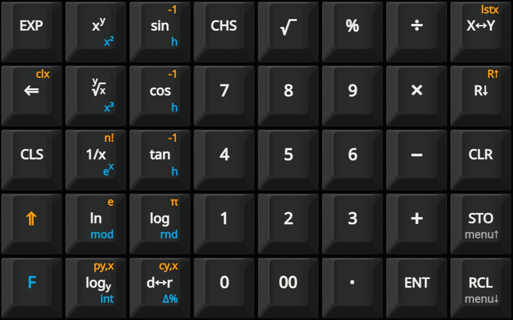
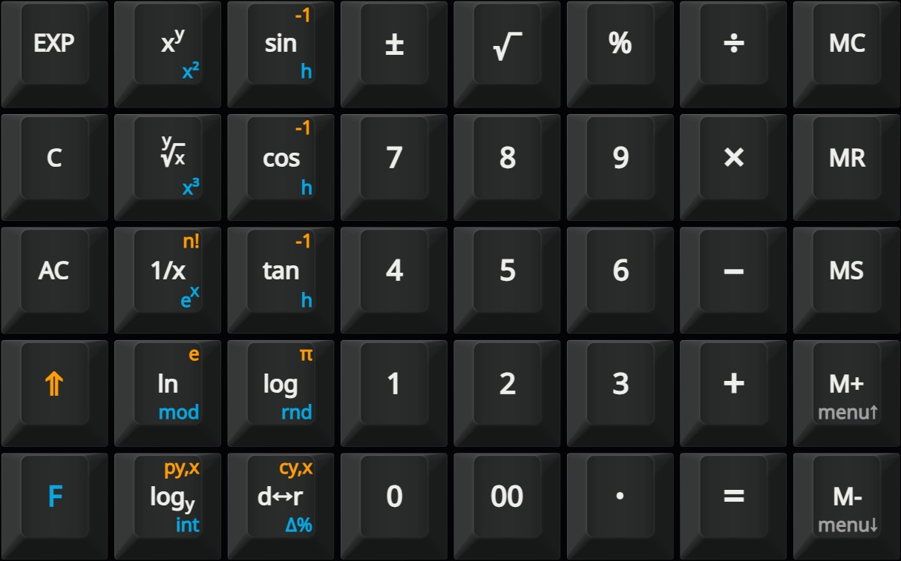

# Keyboard layout and keycaps

For this project we need some custom Cherry MX keycaps. I came up with the keyboard layouts as shown in the pictures. All keycaps are 1x1. 

## RPN keyboard layout

## Algebraic keyboard layout

## Keycaps
If you prefer commercial keycaps, you may use the json design files in the Keycaps directory as a starting point for your own design. You can import the “tf” file into the Thockfactory configurator or the “yz” files into the Yuzu Keycaps advanced editor. 
You can also use transparent keycaps (e.g. from X-keys) and print your own legends. I created the Keycaps/keycaps.svg file with Inkscape, then printed the “Legends” and the “Background” layers on glossy photo paper and finally cut out the “Keys” layer with a cutting plotter.
