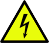
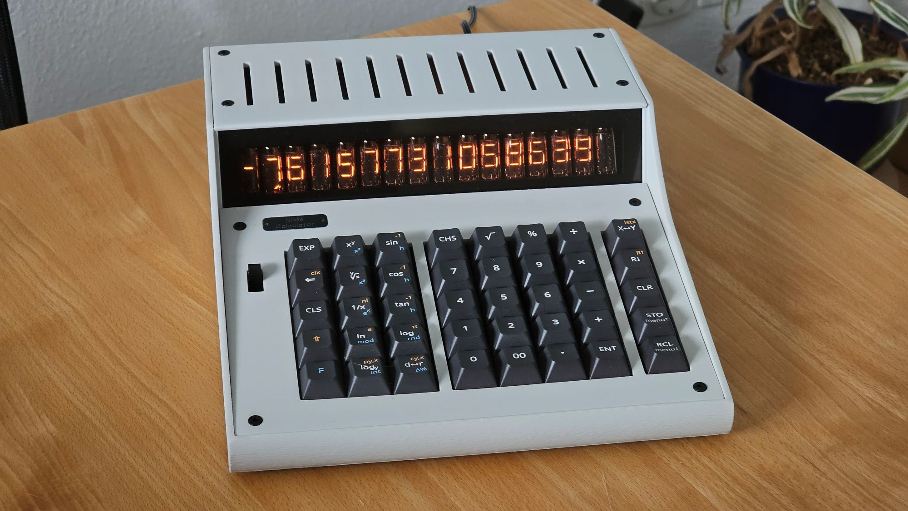

# Retro Calculator

#### This repository contains some information and ideas for building a retro calculator and is provided *as-is* for educational, experimental, and hobbyist purposes only.
##
>[!WARNING]
> #### This is just a hobbyist project. The project has not been tested for compliance with electrical, safety, or electromagnetic standards (e.g., CE, FCC). 
> ### If you choose to build or use the calculator, you are doing so at your own risk.

>[!CAUTION]
> 
> ### Nixie tubes and associated circuitry operate at potentially dangerous voltages.

>[!IMPORTANT]
>Although I wrote the initial firmware myself, it now contains so much AI-generated code that I no longer wish to release it under a specific license or copyright. For this reason, only an AI-generated specification file will be provided.

> [!NOTE]
> - The project is not affiliated with any of the service providers mentioned in this repository.

##
#### Project Status 
- **under construction, untested**

#### Hardware Features
- 6 display types
  - nixie: IN-16, IN-17 and B-5870
  - numitron: IV-9
  - vfd: IV-8
  - 7-segment LED
- 14 digits with decimal points and 2 minus signs
-	easy tube replacement
- LED backlighting/underlighting (not for 7-seg LED version)
-	mechanical keyboard with 40 switches
-	custom keycap legends and colors
-	RTC with battery backup
-	ESP32 based controller board
-	PIR, GPS and temperature sensor module (optional)
-	works with a standard DC 12V/2A regulated power supply (wall wart)
-	3D printed case

#### Numitron IV-9 version

